# Лабораторная работа №2. Простой сайт на Django

**Студент:** Лукис Вадим Вадимович  
**Группа:** K3342  
**Вариант:** 6 (Табло победителей автогонок)

## Цель работы
Овладеть практическими навыками и умениями реализации web-сервисов средствами Django.

---

## Практическая работа 2.1. Модели данных об автовладельцах

### Описание

В приложении `racing` созданы модели данных об автовладельцах:

- `CarOwner` — владелец автомобиля (имя, фамилия, дата рождения, номер паспорта, адрес);
- `Car` — автомобиль (номерной знак, марка, модель, цвет, год выпуска);
- `Ownership` — ассоциативная сущность (промежуточная модель), реализующая связь «многие-ко-многим» между владельцем и автомобилем с дополнительными атрибутами: дата начала и дата окончания владения.

Использованы внешние ключи (`ForeignKey`), поля выбора (`choices`) и правильно оформленная промежуточная модель.

### Код

```python
class CarOwner(models.Model):
    """Модель владельца автомобиля"""
    first_name = models.CharField(max_length=50, verbose_name="Имя")
    last_name = models.CharField(max_length=50, verbose_name="Фамилия")
    birth_date = models.DateField(verbose_name="Дата рождения", null=True, blank=True)
    passport_number = models.CharField(max_length=10, verbose_name="Номер паспорта", unique=True)
    address = models.TextField(verbose_name="Адрес", blank=True, null=True)

    cars = models.ManyToManyField('Car', through='Ownership', verbose_name="Автомобили")

    class Meta:
        verbose_name = "Владелец"
        verbose_name_plural = "Владельцы"

    def __str__(self):
        return f"{self.last_name} {self.first_name}"


class Car(models.Model):
    """Модель автомобиля"""
    BRAND_CHOICES = [
        ('BMW', 'BMW'),
        ('Mercedes', 'Mercedes-Benz'),
        ('Audi', 'Audi'),
        ('Toyota', 'Toyota'),
        ('Honda', 'Honda'),
        ('Ford', 'Ford'),
        ('Volkswagen', 'Volkswagen'),
        ('Nissan', 'Nissan'),
        ('Hyundai', 'Hyundai'),
        ('Kia', 'Kia'),
    ]

    COLOR_CHOICES = [
        ('black', 'Чёрный'),
        ('white', 'Белый'),
        ('red', 'Красный'),
        ('blue', 'Синий'),
        ('silver', 'Серебристый'),
        ('gray', 'Серый'),
    ]

    license_plate = models.CharField(max_length=10, verbose_name="Номер автомобиля", unique=True)
    brand = models.CharField(max_length=20, choices=BRAND_CHOICES, verbose_name="Марка")
    model = models.CharField(max_length=50, verbose_name="Модель")
    color = models.CharField(max_length=10, choices=COLOR_CHOICES, verbose_name="Цвет")
    year = models.IntegerField(verbose_name="Год выпуска")

    class Meta:
        verbose_name = "Автомобиль"
        verbose_name_plural = "Автомобили"

    def __str__(self):
        return f"{self.brand} {self.model} ({self.license_plate})"


class Ownership(models.Model):
    """Промежуточная модель владения автомобилем"""
    car_owner = models.ForeignKey(CarOwner, on_delete=models.CASCADE, verbose_name="Владелец")
    car = models.ForeignKey(Car, on_delete=models.CASCADE, verbose_name="Автомобиль")
    start_date = models.DateField(verbose_name="Дата начала владения")
    end_date = models.DateField(verbose_name="Дата окончания владения", null=True, blank=True)

    class Meta:
        verbose_name = "Владение"
        verbose_name_plural = "Владения"
        unique_together = ['car_owner', 'car']

    def __str__(self):
        return f"{self.car_owner} владеет {self.car} с {self.start_date}"
```

### Результат работы

Созданы и применены миграции, схема БД синхронизирована с кодом:

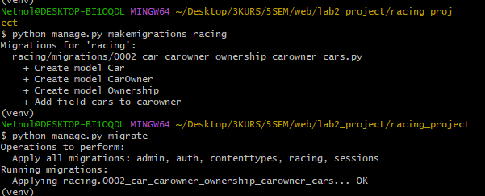

Модели зарегистрированы в Django Admin, записи добавлены через админ-панель:

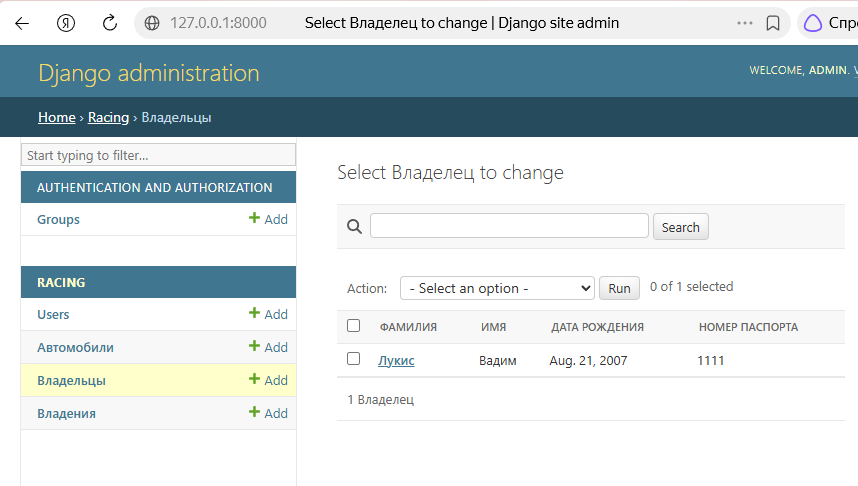

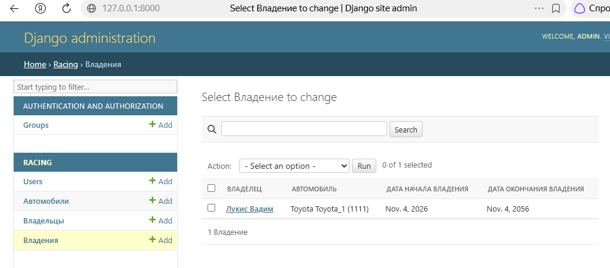

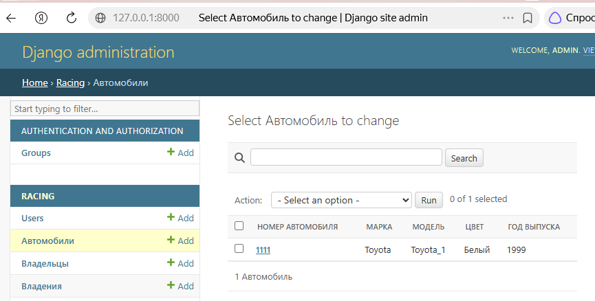

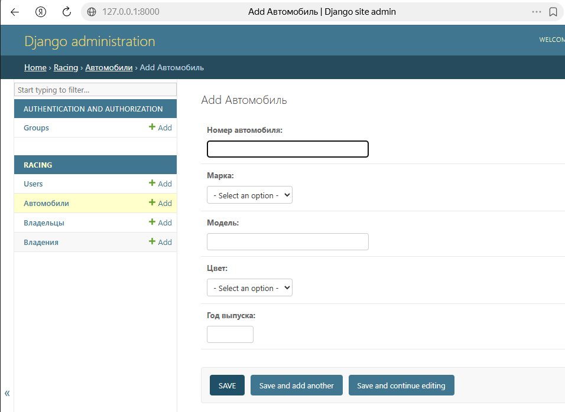

---

## Практическая работа 2.2. CRUD-интерфейсы

### Описание

Для моделей `CarOwner` и `Car` реализованы CRUD-интерфейсы (Create, Read, Update, Delete) средствами представлений на основе функций (FBV): список объектов, детальная страница, создание, редактирование и удаление с подтверждением. Формы построены на `ModelForm`, страницы — на HTML-шаблонах с оформлением Bootstrap.

### Код

Представление создания объекта (`views.py`):

```python
def car_owner_create(request):
    """Создание нового владельца"""
    if request.method == 'POST':
        form = CarOwnerForm(request.POST)
        if form.is_valid():
            form.save()
            messages.success(request, 'Владелец успешно создан!')
            return redirect('car_owner_list')
    else:
        form = CarOwnerForm()
    return render(request, 'racing/carowner_form.html', {'form': form, 'title': 'Добавить владельца'})
```

Форма (`forms.py`):

```python
class CarOwnerForm(forms.ModelForm):
    """Форма для создания/редактирования владельца"""
    class Meta:
        model = CarOwner
        fields = ['first_name', 'last_name', 'birth_date', 'passport_number', 'address']
        widgets = {
            'birth_date': forms.DateInput(attrs={'type': 'date'}),
            'address': forms.Textarea(attrs={'rows': 3}),
        }

    def __init__(self, *args, **kwargs):
        super().__init__(*args, **kwargs)
        for field in self.fields.values():
            if not isinstance(field.widget, (forms.CheckboxInput, forms.RadioSelect, forms.Select)):
                field.widget.attrs.setdefault('class', 'form-control')
```

### Результат работы

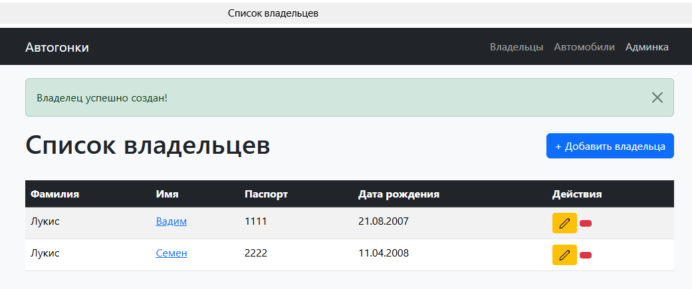

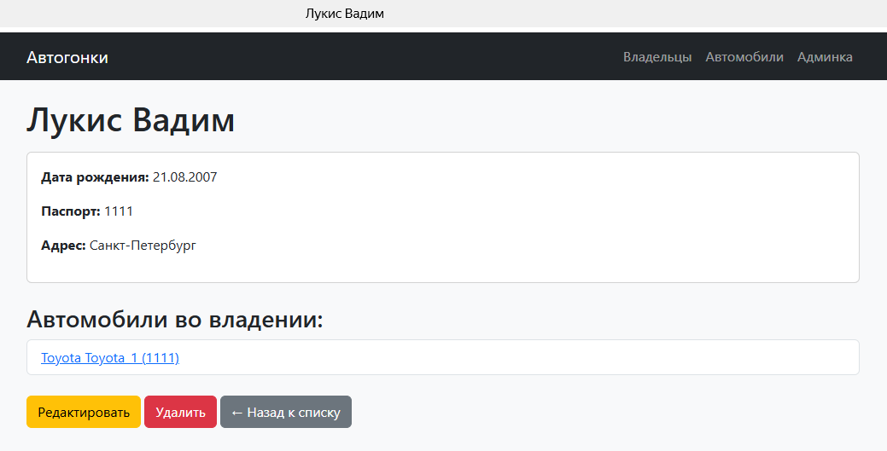

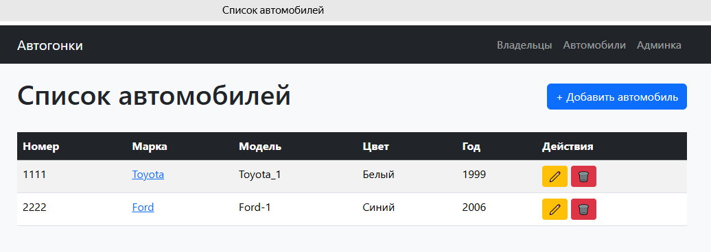

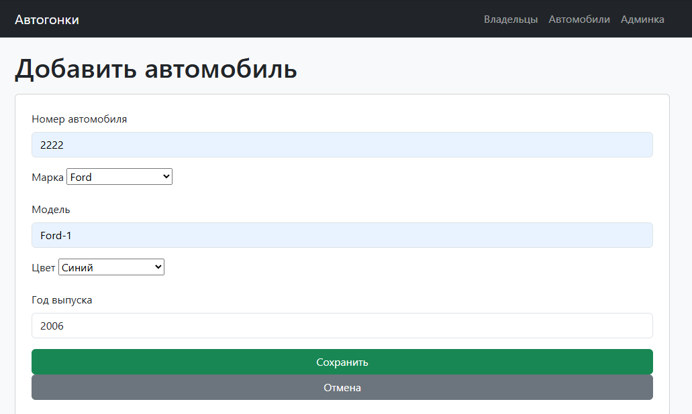

---

## Практическая работа 2.3. Расширение модели пользователя

### Описание

Модель пользователя расширена через `AbstractUser`: к стандартному пользователю добавлены поля «номер паспорта», «домашний адрес», «национальность». Модель подключена через `AUTH_USER_MODEL = 'racing.User'` в `settings.py` до первой миграции. Новые поля отображаются в Django Admin, реализован интерфейс создания пользователя с новыми атрибутами.

### Код

```python
class User(AbstractUser):
    """Расширенная модель пользователя"""
    passport_number = models.CharField(
        max_length=10,
        blank=True,
        null=True,
        verbose_name="Номер паспорта"
    )
    home_address = models.TextField(
        blank=True,
        null=True,
        verbose_name="Домашний адрес"
    )
    nationality = models.CharField(
        max_length=50,
        blank=True,
        null=True,
        verbose_name="Национальность"
    )

    def __str__(self):
        return f"{self.username} ({self.get_full_name()})"
```

Регистрация в админке с новыми полями:

```python
@admin.register(User)
class UserAdmin(BaseUserAdmin):
    fieldsets = BaseUserAdmin.fieldsets + (
        ('Дополнительная информация', {
            'fields': ('passport_number', 'home_address', 'nationality')
        }),
    )
    list_display = ('username', 'email', 'first_name', 'last_name',
                    'passport_number', 'nationality', 'is_staff')
```

### Результат работы

Интерфейс регистрации (создания) пользователя:

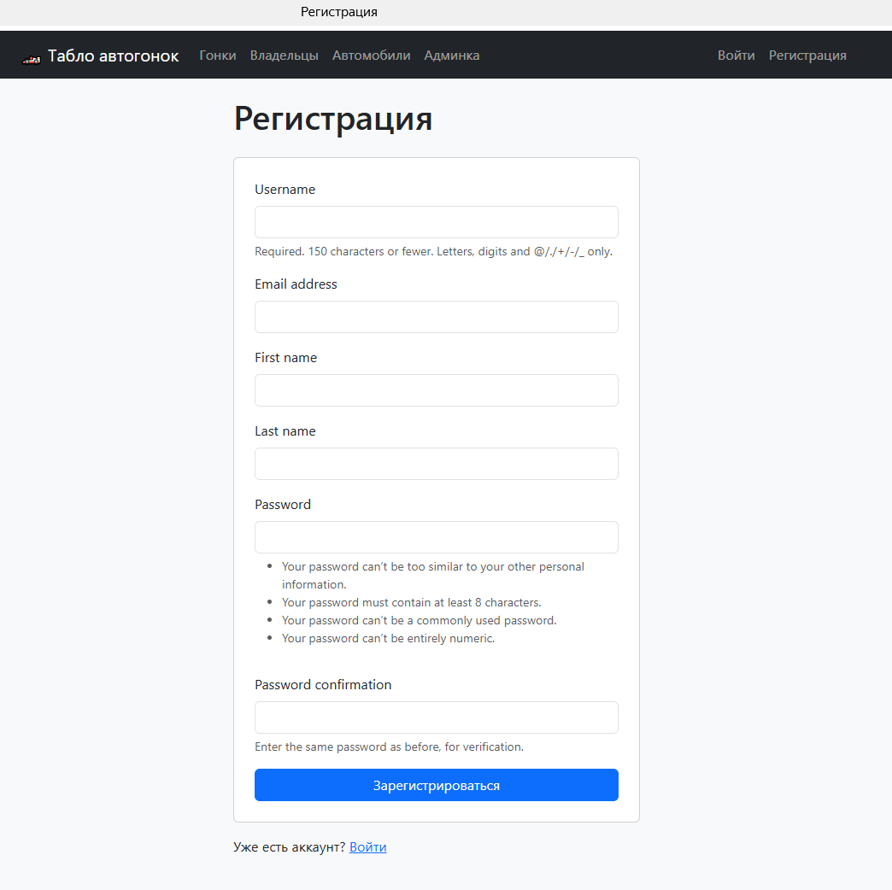

---

## Лабораторная часть. Вариант 6 — Табло победителей автогонок

### Описание

Реализован веб-сервис «Табло победителей автогонок». Хранится информация об участниках автогонок (ФИО участника, название команды, описание автомобиля, описание участника, опыт и класс участника), гонках, регистрациях гонщиков на гонки (с временем заезда и результатом), а также отзывах к гонкам (дата заезда, текст комментария, тип комментария, рейтинг 1–10, информация о комментаторе).

Реализованный функционал:

- регистрация новых пользователей;
- просмотр автогонок и регистрация гонщиков; пользователь может редактировать и удалять свои регистрации;
- написание отзывов и комментариев к автогонкам (только для зарегистрированных пользователей);
- администратор указывает время заезда и результат средствами Django Admin;
- в клиентской части формируется таблица всех заездов и результатов конкретной гонки.

### Модель данных

```python
class Racer(models.Model):
    """Модель гонщика"""
    user = models.OneToOneField(
        User,
        on_delete=models.CASCADE,
        verbose_name="Пользователь",
        related_name='racer_profile'
    )
    first_name = models.CharField(max_length=50, verbose_name="Имя")
    last_name = models.CharField(max_length=50, verbose_name="Фамилия")
    team_name = models.CharField(max_length=100, verbose_name="Название команды")
    car_description = models.TextField(verbose_name="Описание автомобиля")
    experience = models.IntegerField(verbose_name="Опыт (лет)", default=0)
    racer_class = models.CharField(max_length=50, verbose_name="Класс участника")

    class Meta:
        verbose_name = "Гонщик"
        verbose_name_plural = "Гонщики"

    def __str__(self):
        return f"{self.last_name} {self.first_name} ({self.team_name})"


class Race(models.Model):
    """Модель гонки"""
    name = models.CharField(max_length=200, verbose_name="Название гонки")
    race_date = models.DateTimeField(verbose_name="Дата и время гонки")
    track_location = models.CharField(max_length=200, verbose_name="Место проведения")
    description = models.TextField(verbose_name="Описание гонки", blank=True)
    racers = models.ManyToManyField(
        Racer,
        through='RaceRegistration',
        verbose_name="Участники",
        related_name='races'
    )

    class Meta:
        verbose_name = "Гонка"
        verbose_name_plural = "Гонки"
        ordering = ['-race_date']

    def __str__(self):
        return f"{self.name} ({self.race_date.strftime('%d.%m.%Y')})"


class RaceRegistration(models.Model):
    """Промежуточная модель регистрации на гонку"""
    racer = models.ForeignKey(
        Racer,
        on_delete=models.CASCADE,
        verbose_name="Гонщик",
        related_name='registrations'
    )
    race = models.ForeignKey(
        Race,
        on_delete=models.CASCADE,
        verbose_name="Гонка",
        related_name='registrations'
    )
    registration_date = models.DateTimeField(
        auto_now_add=True,
        verbose_name="Дата регистрации"
    )

    race_time = models.CharField(
        max_length=20,
        blank=True,
        null=True,
        verbose_name="Время заезда"
    )
    result = models.PositiveIntegerField(
        blank=True,
        null=True,
        verbose_name="Место (результат)"
    )

    class Meta:
        verbose_name = "Регистрация на гонку"
        verbose_name_plural = "Регистрации на гонки"
        unique_together = ['racer', 'race']

    def __str__(self):
        return f"{self.racer} - {self.race}"


class Review(models.Model):
    """Модель отзыва к гонке"""
    COMMENT_TYPES = [
        ('cooperation', 'Вопрос о сотрудничестве'),
        ('race', 'Вопрос о гонках'),
        ('other', 'Иное'),
    ]

    race = models.ForeignKey(
        Race,
        on_delete=models.CASCADE,
        verbose_name="Гонка",
        related_name='reviews'
    )
    author = models.ForeignKey(
        User,
        on_delete=models.CASCADE,
        verbose_name="Автор отзыва",
        related_name='reviews'
    )
    comment_text = models.TextField(verbose_name="Текст комментария")
    comment_type = models.CharField(
        max_length=20,
        choices=COMMENT_TYPES,
        verbose_name="Тип комментария"
    )
    rating = models.IntegerField(
        verbose_name="Рейтинг (1-10)",
        help_text="Оцените от 1 до 10"
    )
    created_at = models.DateTimeField(
        auto_now_add=True,
        verbose_name="Дата создания"
    )

    class Meta:
        verbose_name = "Отзыв"
        verbose_name_plural = "Отзывы"
        ordering = ['-created_at']

    def __str__(self):
        return f"Отзыв {self.author.username} к {self.race.name}"
```

### Ключевые представления

Создание отзыва к гонке (`views.py`):

```python
@login_required
def review_create(request, pk):
    """Создание отзыва к гонке"""
    race = get_object_or_404(Race, pk=pk)

    if request.method == 'POST':
        form = ReviewForm(request.POST)
        if form.is_valid():
            review = form.save(commit=False)
            review.race = race
            review.author = request.user
            review.save()
            messages.success(request, 'Ваш отзыв добавлен!')
            return redirect('race_detail', pk=pk)
    else:
        form = ReviewForm()

    return render(request, 'racing/review_form.html', {'form': form, 'race': race})
```

### Результат работы

Миграции для моделей лабораторной работы:

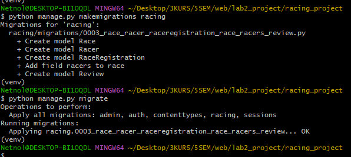

Вход в систему:

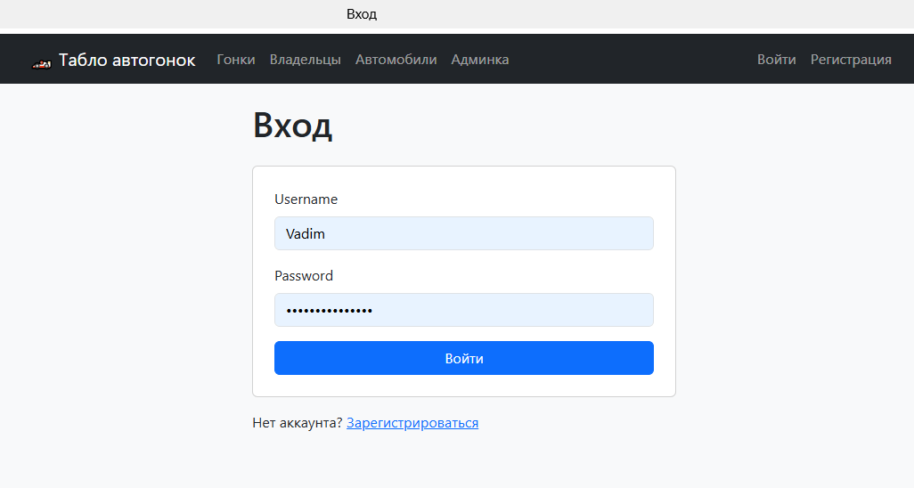

Список гонок:

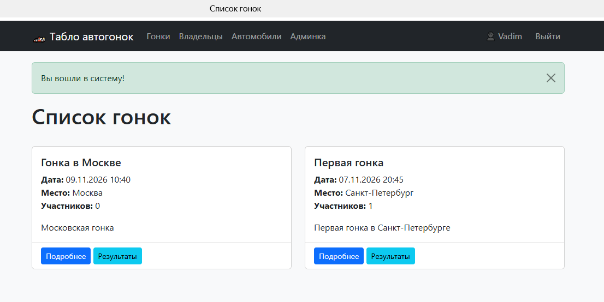

Страница гонки с участниками и отзывами:

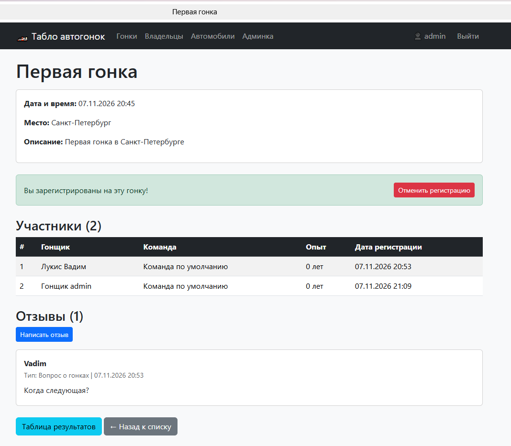

Таблица всех заездов и результатов конкретной гонки:

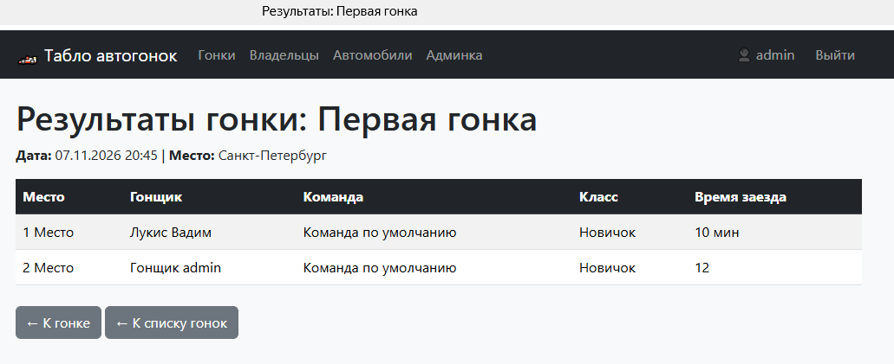

Django Admin: указание администратором времени заезда и результата:

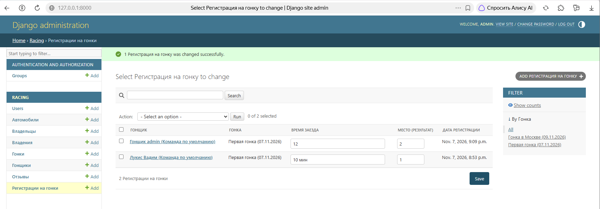

---

## Вывод

В ходе лабораторной работы были освоены практические навыки реализации web-сервисов средствами фреймворка Django. Спроектированы модели данных об автовладельцах и автогонках, реализованы CRUD-интерфейсы, регистрация и аутентификация пользователей, отзывы с рейтингом и типами комментариев, а также таблица всех заездов и результатов гонки. Освоена работа с Django Admin, формами ModelForm и шаблонизатором Django.